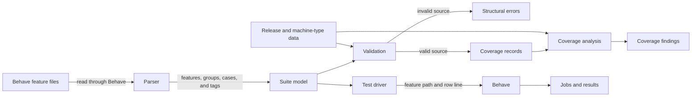

# How the end-to-end test tools fit together

This document describes the proposed result of the current work. It explains
how a change to a Behave feature file reaches validation, coverage analysis,
and test execution.

The feature files remain the source of the tests. The new tools give those
files one shared interpretation. They do not replace the feature files with a
second suite that maintainers must edit.

The terms **scenario**, **parameter group**, **case**, **target**, **job**, and
**result** have the meanings defined in
[`e2e_test_suite.md`](../../reference/e2e_test_suite.md).

## What happens after a maintainer edits a feature file?

Consider a maintainer who adds a row to an `Examples` block and updates that
block's coverage tags.

1. The parser reads the feature file through Behave.
2. The parser produces a **suite model**, a structured description of the
   features, scenarios, `Examples` blocks, rows, parameters, tags, and source
   locations that Behave found.
3. Validation checks that every supported source rule is satisfied. A
   **structural error** is a violation that prevents the tools from producing
   a complete suite model. The command reports the affected source and does
   not produce partial output.
4. For valid source, the command produces one **coverage record** for each
   `Examples` block. The record contains that block's cases, current targets,
   coverage declaration, and source location.
5. Coverage analysis can compare each coverage record with release lifecycle
   information and the releases available for each machine type. A difference
   found after validation succeeds is a **coverage finding**.
6. A test driver can use the same suite model to find one case and invoke its
   current feature path and row line through Behave.

The parser therefore answers what tests exist. Validation answers whether the
source can be interpreted safely. Coverage analysis answers whether the
current rows match the declared coverage. The test driver runs the cases.

## How does information move between the tools?

The walkthrough above introduces every term used in this diagram.

The local command and CI run the same validation. Structural errors fail both
checks. Coverage findings remain separate because a difference in coverage
does not make a feature file impossible to understand.

## What remains the source of the tests?

Maintainers continue to edit:

* Behave feature files;
* coverage tags on each `Examples` block;
* the list of known Ubuntu releases and machine types;
* the releases available for each machine type.

The suite model and coverage records are rebuilt from those files. Maintainers
do not edit either output directly.

This matters because two editable descriptions of the suite would eventually
disagree. Keeping the feature files and repository data as the source means a
reviewer can see the test, its rows, and its coverage declaration in the same
change.

## What does the parser provide?

The parser is the only part of this design that reads Behave's parser objects
and Gherkin source structure. It uses Behave to parse the files, then applies
the additional rules chosen for this suite.

The parser records:

* each feature and uniquely named scenario;
* each `Examples` block;
* every row and all of its parameter values;
* the target from the row's `release` and `machine_type`;
* tags at the feature, scenario, and `Examples` levels;
* the source location of each item;
* the coverage declaration decoded from an `Examples` block's tags.

The parser either produces the complete suite model or reports structural
errors. It never treats a parse failure as if a feature or case did not exist.

## What does validation enforce?

Validation enforces the source rules that every later tool depends on. It
checks, among other things, that:

* scenario names are unique within a feature;
* every `Examples` block contains at least one row;
* every case has a complete and unique set of parameters;
* every row has a known release and machine type;
* coverage tags are on the `Examples` block they describe;
* each coverage declaration is complete and internally consistent;
* the machine-type data gives an answer for every known target.

The initial migration changes the existing feature files to satisfy these
rules. After the migration, the same validation prevents later changes from
reintroducing unsupported shapes.

The local command reports errors before review. CI runs that command again and
blocks a change if the source cannot produce a complete suite model and its
coverage records.

## What does a coverage record describe?

One coverage record describes one `Examples` block. It contains:

* the feature and scenario that contain the block;
* the block's source location and optional name;
* every case and all of its parameter values;
* the distinct release and machine-type targets present in those cases;
* the coverage declaration decoded from the block's tags.

A coverage record is not another test. It groups the information that a
coverage tool needs so that the coverage tool does not parse the feature file
again.

The suite model still contains the runnable cases. The coverage record is the
view of one `Examples` block used for coverage analysis.

## How does regular coverage analysis work?

Coverage analysis compares three facts already defined by this design:

1. **Current cases:** the targets present in the `Examples` rows.
2. **Coverage intent:** the targets named by the block's coverage declaration.
3. **Applicability:** the releases available for each machine type.

For a rolling declaration, release lifecycle information determines which
releases match on the date of the analysis. The coverage tool can then report:

* an intended target with no current case;
* a current target outside the declaration;
* an exception whose date has passed;
* a case for a release and machine type that are not available together.

These are coverage findings. They describe valid source whose rows differ from
the declaration or applicability data. They are not structural errors.

The current epic provides the coverage records needed for this comparison.
Building reports from the findings and deciding whether a finding should block
a merge remain later work.

## How does a test driver use the same suite model?

The test driver reads the cases from the suite model instead of maintaining a
second Behave parser.

A maintainer or another tool selects a case by its scenario and complete set
of parameter values. The case also contains its current feature path and row
line, which the driver passes to Behave to run that exact row.

Running the case creates a job. The job records:

* the scenario and complete parameter values that identify the case;
* the feature path and row line used to invoke Behave;
* the release and machine type used for the machine;
* the tags needed to prepare the test environment;
* the repository revision and whether the checkout had local changes;
* the attempt's times, result, logs, and failure information.

A retry creates another job for the same case. The new job records another
attempt; it does not create another case.

Changing `pro-e2e` or another test driver to use this suite model is later
work. The current work defines the cases and source information that a driver
will need.

## What does this work enable?

The shared definitions and records make several later improvements possible:

* coverage analysis can identify which intended releases and machine types
  have no case, so maintainers can correct those gaps deliberately;
* jobs and results can be tied to exact cases, making it possible to list what
  ran, when it ran, and whether each case passed or failed;
* SRU test suites can show whether their cases ran across every intended
  release and machine type instead of relying on a total job count;
* parser and validation changes happen in one place, so coverage and execution
  tools do not develop different interpretations of the same feature file.

Some of these reports and test-driver changes are later work. This epic
provides the case identity, coverage records, and source information they need.

## Which work belongs to the current epic?

The current epic establishes:

* the suite model and its Behave mapping;
* the coverage declarations written on `Examples` blocks;
* release, machine-type, and applicability data;
* parsing, validation, and coverage records;
* migration of the current feature files to the supported forms;
* local validation and CI enforcement.

The diagram also shows later uses of this work so that their requirements are
not lost. The current epic does not:

* decide whether coverage findings block a merge;
* add cases to close coverage findings;
* schedule machines or manage worker capacity;
* change the test driver to run cases from the suite model.
