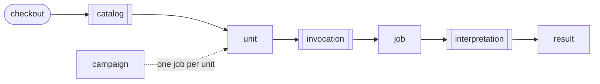
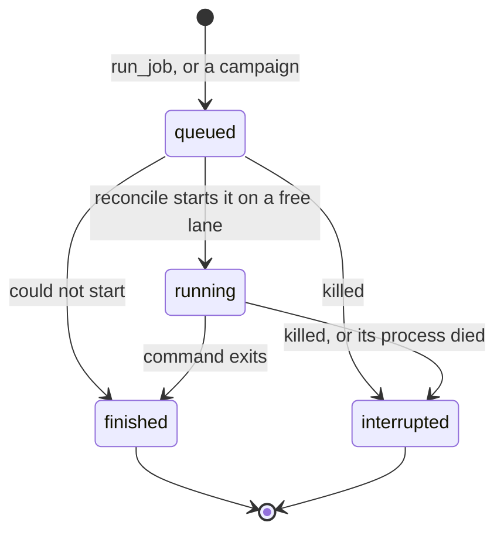
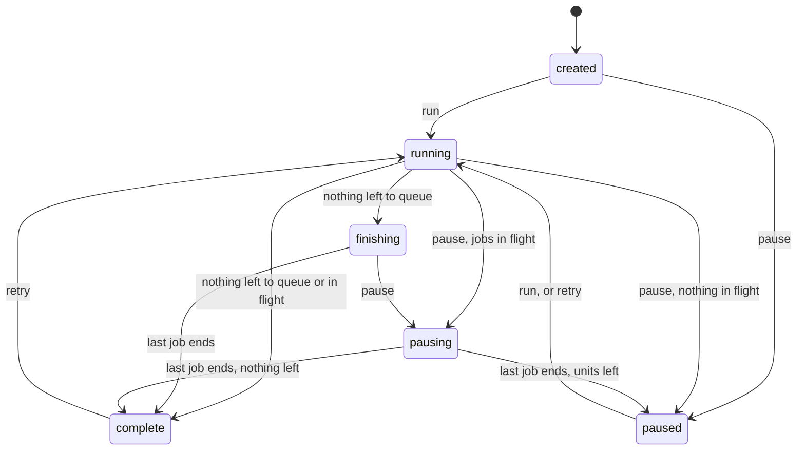

# The pro-e2e domain

pro-e2e runs the pro client's end-to-end scenarios one unit at a time, and runs campaigns of many units with a durable record of every attempt. The concepts here hold whatever test framework runs the scenarios. Each framework fills them in through an adapter; behave is the one in use.

## A caller lists units, runs one, or runs a campaign

A caller lists the units a checkout has, runs one unit and gets its result, or runs a campaign: many units, each run the same way, with every attempt and result kept as a record. The test framework takes part at three points, drawn with double borders.

## Each concept has one name

| Term | Means |
| --- | --- |
| feature | A file of related scenarios. |
| scenario | A named test in a feature. |
| combo | A `{release, machine_type}` pair a scenario supports. |
| unit | A scenario on one combo. What a caller runs and gets a result for. |
| instance | One execution inside a unit. A unit has several when the scenario varies other parameters on the same combo. |
| job | One attempt at one unit. |
| result | What a finished job established: an outcome, the failures, and a reason when the outcome is `error`. |
| outcome | `passed`, `failed`, `skipped` or `error`. |
| failure | One failing instance: where it failed, and the message. |
| pool | A kind of capacity, limited on its own: `lxd`, `cloud` or `wsl`. Each machine type draws on one pool. |
| lane | One slot in a pool. A running job holds one lane. |
| max jobs | How many lanes a pool has. The checkout sets it for all jobs, and each campaign sets its own cap. |
| campaign | A scope of units, with their attempts and outcomes kept as records. |
| scope | The features, scenarios, releases and machine types a campaign was created over. Empty means all. |
| attempt | One job for a unit within a campaign, from its start to its end. |
| intent | What a caller last asked a campaign to do: run, or hold. |
| progress | How much work a campaign has left, read off its units. |
| record | One fact written to a campaign's log. |
| reconcile | One pass that brings jobs and campaigns up to date from their files. |
| state directory | Where one server keeps every job, campaign and lane, `.pro-e2e/` by default. |

## Behave plugs in at three seams

The framework takes part at three seams, and each answers one question for the rest of the tool:

| Seam | Answers |
| --- | --- |
| catalog | Which features, scenarios and combos does this checkout have? |
| invocation | Which command, environment and instances run this unit? |
| interpretation | What did the job establish, and where in its log did it fail? |

## Each framework fills the domain in its own terms

| Term | behave | pytest |
| --- | --- | --- |
| feature | `.feature` file | test module |
| scenario | Scenario, Scenario Outline | test function |
| combo | Examples columns, or the first `Given` step | parameters |
| unit | `--name` with `-D releases` and `-D machine_types` | the scenario's node ids on that combo |
| instance | Examples row | parametrize case |
| job | a `tox -e behave` run | a pytest run |
| result | read from the JSON report | read from pytest's report |
| failure | the failing step | the failing assertion |
| run options | `UACLIENT_BEHAVE_*` variables | whatever the pytest harness reads |

## The harness supplies releases, machine types, pools and run options

Some facts come from the pro client's integration harness and would stay the same under another framework:

- Each machine type draws on one pool. Cloud machine types cost money, so the cloud pool is off until max jobs is set. WSL jobs share one Windows host, so the WSL pool has at most one lane.
- The install source says where the pro client under test comes from: `local`, `archive`, `daily`, `staging`, `stable` or `proposed`.
- Run options, such as contract tokens and cloud credentials, are set once for the checkout. Secrets are never shown, only whether they are set.

## A job is queued, runs, then finishes or is interrupted

A job's state is read off its files and its lock, so any process can read it. A killed job is interrupted with reason `killed`, and a job whose process died is interrupted with reason `died`. An interrupted job established nothing, and it is never an error. A job that could not start finishes, with the reason.

## A unit's state comes from its attempts

A unit is `unattempted`, `in_flight`, or the outcome of its deciding attempt: `passed`, `failed`, `skipped` or `error`.

- A unit with a job queued or running is `in_flight`, whatever came before.
- A pass stands. A unit that has ever passed is `passed`, whatever came before or after.
- Otherwise the latest finished attempt decides. An interrupted attempt never decides.

A campaign queues a unit when nothing is in flight for it and it is unattempted, a retry is pending, or its last attempt was interrupted. A unit with a problem outcome (`failed`, `skipped`, `error`) waits for someone to ask for a retry, because judging a failure flaky or real is the watcher's call.

## A campaign's state is its intent and its progress

Intent is the only state a command writes. Progress is derived from the units:

| Progress | Means |
| --- | --- |
| untouched | No unit has been attempted. |
| open | At least one unit can be queued. |
| finishing | Nothing can be queued, but a job is in flight. |
| settled | Nothing can be queued and nothing is in flight. |

The named state follows from intent, progress and whether a job is in flight. The commands are `run`, `pause` (with an optional kill) and `retry`, which always sets the intent to run. No state is terminal: a complete campaign can be retried.

## Records are facts, and everything else is derived

- A job's files are each written once: the request when it is queued, the launch record when it starts, and the result when it ends.
- A campaign's header and plan are written once, at creation. Every later fact is appended to its record log: intents, retries, attempts and how they ended, starved pools and overdue jobs. A starved pool or an overdue job is recorded once per episode.
- Unit states, progress, the named state and the event feed are rebuilt from the records on every read. Events are never stored.
- Reconcile decides from files alone, under one lock per state directory, so its result is the same whoever runs it. Every server and CLI command runs it, and a job's own process runs the job part of it when the job ends.
